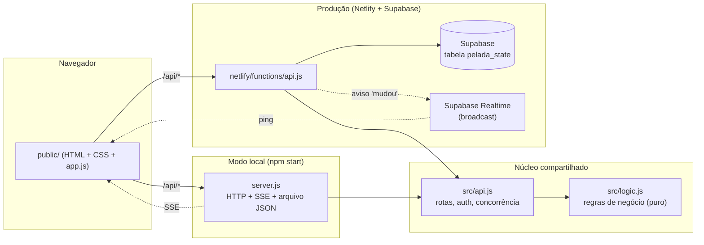
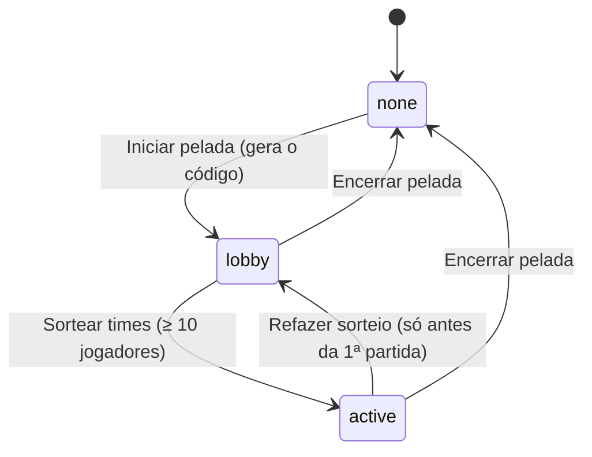

# Documentação técnica — Sistema de gestão de pelada

Este documento descreve como o sistema funciona por dentro: arquitetura, modelo de dados, regras de negócio, API, segurança, deploy e testes. Para instalar e publicar, veja também o [README](../README.md).

## Sumário

1. [Visão geral](#1-visão-geral)
2. [Arquitetura](#2-arquitetura)
3. [Estrutura do repositório](#3-estrutura-do-repositório)
4. [Modelo de dados](#4-modelo-de-dados)
5. [Regras de negócio](#5-regras-de-negócio)
6. [API HTTP](#6-api-http)
7. [Concorrência e consistência](#7-concorrência-e-consistência)
8. [Tempo real e cronômetro](#8-tempo-real-e-cronômetro)
9. [Front-end](#9-front-end)
10. [Segurança](#10-segurança)
11. [Configuração e variáveis de ambiente](#11-configuração-e-variáveis-de-ambiente)
12. [Deploy e operação](#12-deploy-e-operação)
13. [Desenvolvimento e testes](#13-desenvolvimento-e-testes)
14. [Limitações conhecidas e evolução](#14-limitações-conhecidas-e-evolução)

---

## 1. Visão geral

Sistema web para organizar uma **pelada** (futebol amador) por ordem de chegada: cadastro de jogadores, sorteio equilibrado dos dois primeiros times, fila de espera, partidas com cronômetro, registro de gols e assistências e ranking da temporada. É usado principalmente **pelo celular**.

Dois perfis:

| Perfil | Como entra | O que pode |
|---|---|---|
| **Administrador** | Senha (`ADMIN_PASSWORD`) no campo "Sou o administrador" | Tudo: cadastrar jogadores, iniciar/encerrar a pelada, marcar chegadas, sortear, controlar a partida, registrar/desfazer gols, tirar jogadores, mudar regras, zerar a temporada. Vê o nível dos jogadores. |
| **Espectador** | Código de 5 caracteres da pelada em andamento | Só leitura: placar, tempo, times em campo, fila e ranking. **Não vê o nível dos jogadores.** O **ranking é público** (não exige código). |

Requisitos de negócio resumidos (detalhes na [seção 5](#5-regras-de-negócio)): times sempre completos (5 jogadores), goleiro apenas informativo, fila por ordem de chegada, vencedor continua em campo, regras especiais de empate, ranking só da temporada atual.

## 2. Arquitetura

O código é organizado em camadas. As **regras de negócio ficam em um módulo puro** (`src/logic.js`), sem rede nem disco, e são compartilhadas pelos dois modos de execução.



### Dois modos de execução

| | Local (`npm start`) | Produção (Netlify + Supabase) |
|---|---|---|
| Quem atende a API | `server.js` (Node `http`, sem dependências) | `netlify/functions/api.js` (função serverless) |
| Onde guarda o estado | Arquivo `data/db.json` | Linha única da tabela `public.pelada_state` |
| Como avisa os celulares | SSE (`/api/stream`) | Supabase Realtime (broadcast) + polling |
| Fim da partida por tempo | Servidor confere a cada 500 ms | Conferido ao **ler** o estado (não há processo contínuo) |
| Senha do admin | `ADMIN_PASSWORD` (padrão `admin123`) | `ADMIN_PASSWORD` **obrigatória** |

### Contrato do "store"

`src/api.js` não sabe onde os dados ficam. Ele recebe um objeto com três operações:

```text
load()             -> { db, version }   // db é uma CÓPIA, pode ser alterada à vontade
save(db, version)  -> boolean           // false se outra requisição salvou antes (conflito)
notify()           -> void              // avisa os clientes que algo mudou
```

Há duas implementações: o armazenamento em arquivo dentro de `server.js` e `src/supabase-store.js`.

### Fluxo de uma ação do admin (produção)

1. O celular do admin faz `POST /api/match/goal` (cabeçalho `Authorization: Bearer <token>`).
2. A função carrega o estado (`load`), confere o token, aplica a regra (`logic.recordGoal`) e tenta gravar (`save` com a `version` lida).
3. Se gravou, dispara `notify` (broadcast no canal `pelada`) e responde com o estado já atualizado.
4. Os demais celulares recebem o aviso do Realtime e pedem `GET /api/state` (a API valida o código da pelada).

## 3. Estrutura do repositório

```text
.
├── public/                       Front-end estático (publicado pelo Netlify)
│   ├── index.html                  Casca da página (topo, abas, modal, toast)
│   ├── style.css                   Estilos (mobile first, tema escuro)
│   └── app.js                      Toda a interface e a comunicação com a API
├── src/
│   ├── logic.js                    Regras de negócio (funções puras sobre o objeto db)
│   ├── api.js                      Rotas, autenticação, controle de concorrência
│   └── supabase-store.js           Armazenamento no Supabase (REST + broadcast)
├── netlify/functions/api.js      Adaptador: evento do Netlify -> src/api.js
├── server.js                     Servidor local (HTTP + SSE + arquivo JSON)
├── netlify.toml                  Publicação, funções e redirecionamento /api/*
├── supabase/migrations/          SQL da tabela do estado (com RLS)
├── scripts/seed.js               Cadastra 25 jogadores de exemplo
├── test/                         Testes automatizados (node:test)
├── docs/                         Esta documentação
├── .env.example                  Modelo das variáveis de ambiente
└── package.json                  Scripts (sem dependências de runtime)
```

O projeto **não tem dependências npm**: usa só módulos nativos do Node (`http`, `crypto`, `fs`, `node:test`) e `fetch` global (Node ≥ 18). No navegador, o único recurso externo é o `supabase-js` (carregado por CDN, versão fixa) para o Realtime.

## 4. Modelo de dados

Todo o estado é **um único objeto JSON** (`db`). Em produção ele é guardado na coluna `data` (tipo `jsonb`) de uma tabela com uma só linha.

### 4.1 Objeto `db`

```jsonc
{
  "secret": "hex...",          // segredo para assinar o token do admin (nunca sai da API)
  "season": 1,                  // número da temporada (só um contador)
  "config": { "matchSeconds": 420, "goalsToWin": 2, "teamSize": 5 },
  "players": [ /* Player */ ],  // cadastro fixo
  "session": { /* Session */ }, // a pelada em andamento
  "events":  [ /* GoalEvent */ ], // gols/assistências da temporada (base do ranking)
  "matches": [ /* MatchResult */ ] // partidas finalizadas da temporada
}
```

Só **`players`** e **`config`** sobrevivem ao "Começar nova temporada". `events` e `matches` são apagados e `season` é incrementado — **não há histórico de temporadas anteriores** (requisito do produto).

### 4.2 Entidades

**Player**
```jsonc
{ "id": "a1b2c3d4e5", "name": "Ana", "level": "fraco|medio|bom", "position": "gol|linha" }
```
- `name`: 1 a 40 caracteres, único sem diferenciar maiúsculas.
- `level` vale 1/2/3 no sorteio (`LEVELS`). Só o admin recebe esse campo.
- `position: "gol"` torna o jogador **apenas informativo**: ele não entra em chegada, sorteio, times nem fila.

**Session** (`db.session`)
```jsonc
{
  "status": "none | lobby | active",
  "code": "K7X2M",            // código dos espectadores (null em "none")
  "arrivals": ["id", ...],     // ordem de chegada ANTES do sorteio (status lobby)
  "arrivalOrder": ["id", ...], // cópia usada por "Refazer sorteio"
  "teams": [ Team, Team ],     // os dois times em campo
  "queue": ["id", ...],        // fila de espera, por ordem de chegada
  "matchesPlayed": 0,
  "match": Match,
  "lastResult": MatchResult | null
}
```

**Team** — só os times em campo existem como "time"; a fila é uma lista de ids.
```jsonc
{ "id": "…", "name": "Time Laranja", "color": "#f2994a", "players": ["id", ...] }
```
Cores: **laranja** (`#f2994a`) e **verde** (`#27ae60`). Um time novo sempre recebe a cor diferente do que ficou em campo.

**Match** (`session.match`)
```jsonc
{
  "id": "…",
  "status": "idle | running | paused | finished",
  "elapsedMs": 0,           // tempo já jogado, somado nas pausas
  "startedAt": null,        // epoch ms do último "play" (null se parado)
  "teamIds": ["id","id"],   // times que iniciaram a partida
  "goals": [ Goal ],
  "reason": null            // "gols" | "tempo" | "manual" quando finished
}
```

**Goal** / **GoalEvent**
```jsonc
{ "id": "…", "teamId": "…", "teamName": "Time Laranja", "ms": 63000,
  "scorerId": "…", "scorerName": "Ana", "assistId": "…|null", "assistName": "Beto|null" }
```
`events` guarda o mesmo gol com `matchId`, `season` e `at`. Os **nomes são copiados** (snapshot) para o ranking sobreviver à exclusão do cadastro de um jogador.

**MatchResult** (`matches[]` e `session.lastResult`): `{ id, endedAt, reason, season, teamA, teamB, scoreA, scoreB, winner, goals }`, com `teamA`/`teamB` como `{ id, name, color, players: [nomes] }`.

### 4.3 Tabela no Supabase

```sql
create table public.pelada_state (
  id         int primary key check (id = 1),   -- sempre uma única linha
  data       jsonb not null,                   -- o objeto db inteiro
  version    int not null default 0,           -- controle otimista de concorrência
  updated_at timestamptz not null default now()
);
alter table public.pelada_state enable row level security;   -- sem nenhuma policy
revoke all on public.pelada_state from anon, authenticated;
```
Arquivo: `supabase/migrations/20261020000000_pelada_state.sql`.

### 4.4 Migração de dados antigos

`normalizeDb()` roda a cada leitura do estado. Ela completa campos que faltam (`defaultDb`) e converte formatos antigos: times de fila viram jogadores na `queue`, `paused`/`gkQueue`/`teamCounter` são removidos e goleiros são retirados de chegada, times e fila (`refill` repõe os times em campo).

## 5. Regras de negócio

Todas em `src/logic.js`. Os parâmetros `teamSize`, `goalsToWin` e `matchSeconds` vêm de `db.config` (padrão **5**, **2** e **420 s**). Os números abaixo usam o padrão.

### 5.1 Ciclo da pelada (`session.status`)



- **`none`**: sem pelada. Espectadores só veem o ranking e a tela de entrada.
- **`lobby`**: o admin marca "Chegou"; a ordem de chegada é guardada em `arrivals`.
- **`active`**: times sorteados, partidas acontecendo.
- "Encerrar pelada" descarta times e fila e **invalida o código**; gols e assistências continuam na temporada.

### 5.2 Chegada e goleiros

- Marcar chegada exige pelada iniciada e jogador cadastrado e ainda fora da pelada.
- **Goleiro (`position: "gol"`) é recusado** na chegada. Se um jogador presente for editado para goleiro, ele sai da pelada na hora.
- Depois do sorteio, quem chega **entra no fim da fila** (`queue`). Só sobe direto para um time em campo se faltar gente lá (vaga aberta com fila vazia).

### 5.3 Sorteio inicial (`draw`)

- Exige `status = lobby` e **pelo menos `2 × teamSize` (10) chegadas**.
- Os **10 primeiros por ordem de chegada** entram no sorteio; os demais viram a `queue` na ordem em que chegaram (sem sorteio).
- `balancedDraw` faz 2000 divisões aleatórias dos 10 em 2 times e fica com a de menor desequilíbrio, medido por: `diferença das médias de nível × 100 + diferença de jogadores "bom" × 10 + diferença de jogadores "fraco"`. Empates na pontuação são sorteados.
- Nível: fraco = 1, médio = 2, bom = 3. O equilíbrio vale **só nesta etapa**; depois a composição segue a ordem de chegada.
- "Refazer sorteio" (`redraw`) só é permitido antes da primeira partida; devolve todos à lista de chegada na ordem original.

### 5.4 Times sempre completos

- Uma partida **só inicia com os dois times com `teamSize` jogadores** (`startMatch`).
- Quando alguém **sai** (`removePlayer`, botão ✕) ou **vai para o fim da fila** (`sendToBack`, botão ↧), o **primeiro da fila sobe** para a vaga (`refill`), inclusive com a partida em andamento.
- `sendToBack` de quem está em campo exige alguém esperando; sem fila a ação é recusada. Para quem já está na fila, só muda a posição para o fim.
- Se a fila está vazia, a vaga fica aberta até alguém chegar.

### 5.5 Partida

Estados: `idle → running ⇄ paused → finished`.

| Ação | Regra |
|---|---|
| Iniciar | `idle` → `running`, guarda `startedAt` e os `teamIds`. |
| Pausar / Retomar | Pausar soma o tempo decorrido em `elapsedMs`; retomar grava novo `startedAt`. Não retoma se o tempo já acabou. |
| Encerrar (manual) | Vai para `finished` com `reason = "manual"`. |
| Fim por tempo | `elapsed ≥ matchSeconds` → `finished`, `reason = "tempo"`. Avaliado por `tick()`. |
| Fim por gols | Ao registrar um gol, se o time chega a `goalsToWin` → `finished`, `reason = "gols"`. |
| Desfazer gol | Remove o gol do jogo e do ranking. Se o gol decisivo for desfeito, a partida **reabre** (volta a `paused`). |

Tempo decorrido = `elapsedMs + (agora − startedAt)`, limitado a `matchSeconds`.

**Gol** (`recordGoal`): só com partida `running` ou `paused`; autor e assistente (opcional) precisam estar no time e não podem ser a mesma pessoa. Cria o gol na partida e o evento no ranking.

### 5.6 Fim de jogo e rotação (`nextMatch`)

O admin confirma com "Próxima partida" (ou escolhendo o vencedor, no empate). Com `queue.length` = número de jogadores esperando:

| Situação | O que acontece |
|---|---|
| **Um time vence** (qualquer placar) | O **vencedor fica**. O perdedor vai para o **fim da fila**. Os **5 primeiros da fila** formam o novo desafiante (cor oposta). Se o vencedor estava incompleto, a fila o completa primeiro. |
| **Fila vazia** | Os mesmos dois times jogam de novo. |
| **Empate, fila de 1 a 5** | Sai o time desafiante (2º time); o admin pode, se quiser, escolher o vencedor. |
| **Empate, fila de 6 a 7** (próximo time completo + 1 a 2 no "time de ré") | O admin **precisa definir o vencedor**. O vencedor fica; o perdedor vai para o fim da fila e, por ordem, seus primeiros jogadores **completam o time de ré**. |
| **Empate, fila ≥ 8** (`teamSize + 3`) | **Os dois times saem.** O admin **precisa definir o vencedor**. A fila vira: `fila atual + time vencedor + time perdedor` (cada um na ordem em que estava). Os 5 primeiros entram como novo time e os 5 seguintes como segundo time (a cor laranja vai para o primeiro, verde para o segundo). Se faltar gente no segundo, quem acabou de sair completa. |

Funções relacionadas: `needsTiebreak()` (empate com fila entre `teamSize+1` e `teamSize+3`) e `needsBothOut()` (empate com fila ≥ `teamSize+3`). Ambas são enviadas ao front como `session.needsTiebreak` e `session.bothOut`. Se o empate exige vencedor e `winnerTeamId` não vem, a API devolve erro 400 ("Empate: defina qual time ganhou").

A cada fim de jogo confirmado a partida é registrada em `db.matches` e em `session.lastResult`, e `matchesPlayed` é incrementado.

### 5.7 Ranking e selos

- Calculado **na hora** a partir de `db.events`: por jogador, `goals` e `assists`; **participações = gols + assistências**.
- Três visões: Gols, Assistências e Participações (empates desempatam por gols, depois assistências, depois nome).
- **Selos** (calculados no front): ⚽ dourado = mais gols (bola de ouro), 👟 dourado = mais assistências (chuteira de ouro), 👑 = mais participações. Em caso de empate no topo, todos os empatados recebem o selo.
- "Começar nova temporada" apaga `events`, `matches` e `lastResult`, e incrementa `season`. Cadastro de jogadores e regras permanecem.

### 5.8 Configurações (`setConfig`)

| Campo | Limites | Restrições |
|---|---|---|
| `matchSeconds` | 30 a 3600 | Não muda com partida `running`/`paused`. |
| `goalsToWin` | 1 a 20 | Idem. |
| `teamSize` | 2 a 11 | Também não muda depois do sorteio (`status = active`). |

## 6. API HTTP

Base: `/api`. Corpo e respostas em JSON. Um objeto `req` abstrato (`method`, `pathname`, `query`, `headers`, `body`) é tratado por `api.handle(store, req)`, igual nos dois modos.

### 6.1 Autenticação

1. `POST /api/login` com `{ "password": "…" }` devolve `{ "token": "<hex>" }`.
2. O token é `HMAC-SHA256(db.secret, "admin:" + ADMIN_PASSWORD)`. Ele é enviado depois em `Authorization: Bearer <token>`. Trocar a senha ou o `secret` invalida todos os tokens.
3. O `EventSource` do navegador não envia cabeçalhos, então o stream local aceita `?token=`.
4. As comparações usam `crypto.timingSafeEqual` sobre hashes SHA-256.

Espectadores não têm token: informam o código em `?code=XXXXX`.

### 6.2 Leitura (públicas)

| Método e rota | Resposta |
|---|---|
| `GET /api/config` | `{ "realtime": { "url", "anonKey" } }` em produção; `{ "realtime": null }` no modo local (o front usa SSE). |
| `GET /api/state?code=…` | Estado visível para quem pergunta (veja 6.4). Também encerra a partida se o tempo acabou. |
| `GET /api/me` | `{ "admin": true|false }` |
| `GET /api/stream` | **Só no modo local.** SSE; manda o estado a cada mudança. Aceita `?code=` e `?token=`. |

### 6.3 Escrita (somente admin — `401` sem token válido)

| Método e rota | Corpo | Efeito |
|---|---|---|
| `POST /api/players` | `{ name, level, position }` | Cadastra jogador |
| `PUT /api/players/:id` | idem | Edita (goleiro sai da pelada) |
| `DELETE /api/players/:id` | — | Exclui o cadastro (gols continuam no ranking) |
| `POST /api/session/start` | — | Inicia a pelada e gera o código |
| `POST /api/session/end` | — | Encerra a pelada |
| `POST /api/session/checkin` | `{ playerId }` | Marca chegada |
| `POST /api/session/draw` | — | Sorteia os times |
| `POST /api/session/redraw` | — | Desfaz o sorteio (antes da 1ª partida) |
| `POST /api/session/players/:id/back` | — | Manda para o fim da fila |
| `POST /api/session/players/:id/remove` | — | Tira do futebol de hoje |
| `POST /api/match/start` · `pause` · `resume` · `finish` | — | Controle da partida |
| `POST /api/match/goal` | `{ teamId, scorerId, assistId? }` | Registra gol |
| `DELETE /api/match/goals/:id` | — | Desfaz gol |
| `POST /api/match/next` | `{ winnerTeamId? }` | Fim de jogo e rotação |
| `PUT /api/config` | `{ matchSeconds, goalsToWin, teamSize }` | Regras da partida |
| `POST /api/season/reset` | — | Nova temporada (zera ranking) |

Toda escrita responde com o **estado já atualizado** (mesmo formato de `GET /api/state` para o admin).

### 6.4 Formato do estado (`viewState`)

Para o **admin**, ou para o espectador com **código válido**:

```jsonc
{
  "now": 1792536448222,            // relógio do servidor (o front calcula o offset)
  "admin": true,
  "season": 1,
  "ranking": [ { "id", "name", "goals", "assists" } ],
  "config": { "matchSeconds", "goalsToWin", "teamSize" },
  "players": [ ... ],              // admin: com "level"; espectador: só id, name, position
  "session": {
    "status", "code" /* só admin */, "arrivals", "teams", "queue",
    "matchesPlayed", "match", "needsTiebreak", "bothOut"
  }
}
```

Para o espectador **sem pelada** ou com **código errado** o estado é "travado" e traz só o ranking:

```json
{ "now": 0, "admin": false, "season": 1, "ranking": [], "locked": true, "message": "Código inválido ou pelada encerrada." }
```

### 6.5 Erros

| Código | Quando | Corpo |
|---|---|---|
| 400 | Validação de regra (ex.: "Cada time precisa ter 5 jogadores…") | `{ "error": "mensagem em português" }` |
| 401 | Senha errada no login ou escrita sem token | idem |
| 404 | Rota ou jogador/gol inexistente | idem |
| 413 | Corpo maior que 100 KB (só servidor local) | idem |
| 503 | Conflito de gravação repetido 10 vezes | idem |
| 500 | Erro inesperado (detalhe só no log do servidor) ou configuração inválida no Netlify (mensagem clara) | idem |

### 6.6 Exemplo

```bash
BASE=https://seu-site.netlify.app
TOKEN=$(curl -s -X POST $BASE/api/login -d '{"password":"SUA_SENHA"}' | sed 's/.*"token":"\([^"]*\)".*/\1/')
curl -s -X POST $BASE/api/session/start -H "Authorization: Bearer $TOKEN"
```

## 7. Concorrência e consistência

Como a função serverless é sem estado e várias pessoas usam ao mesmo tempo, toda escrita usa **controle otimista de concorrência** (`mutate` em `src/api.js`):

1. `load()` devolve uma cópia do estado e sua `version`.
2. A regra é aplicada na cópia. Se lançar `AppError`, nada é gravado.
3. `save(db, version)` só grava se a versão no banco ainda for a lida. No Supabase é um `PATCH ... ?id=eq.1&version=eq.N` que devolve a linha só se bateu.
4. Se alguém gravou antes, o ciclo se repete (até **10 tentativas**); depois disso responde 503.

Leituras (`GET /api/state`) também passam por `mutate`, mas só gravam se `tick()` encerrou uma partida, evitando escrita desnecessária.

## 8. Tempo real e cronômetro

### Atualização dos celulares

- **Produção:** depois de cada gravação a função envia um broadcast no canal `pelada` (`POST {SUPABASE_URL}/realtime/v1/api/broadcast`) **sem dados**. O navegador assina o canal com o `supabase-js` e, a cada aviso, chama `GET /api/state`. Assim o código da pelada e o nível dos jogadores continuam protegidos pela API.
- **Local:** `GET /api/stream` (SSE) mantém conexões abertas e envia o estado de cada cliente (já filtrado por perfil).
- **Garantias extras:** consulta a cada **10 s** em produção, e uma consulta imediata quando o cronômetro chega a zero.

### Cronômetro

O servidor guarda `elapsedMs` e `startedAt`; o navegador desenha o relógio localmente a cada 250 ms usando o `now` do servidor para corrigir diferença de relógio. Para encerrar por tempo:

- **Local:** `setInterval` de 500 ms chama `api.tick`.
- **Produção:** não existe processo contínuo. A partida é encerrada **ao ler o estado**. O celular que vê o tempo chegar a zero pede o estado (`fetchState`), o que dispara o encerramento e o aviso aos demais.

### Som

No navegador (Web Audio, sem arquivos): 1 apito quando a partida passa de `idle` para `running` e 3 apitos quando passa para `finished`, em todos os celulares conectados. Navegadores só liberam áudio depois de um toque; qualquer clique na página destrava. O botão 🔊/🔇 liga e desliga e a escolha fica no `localStorage`.

## 9. Front-end

Aplicação de página única em JavaScript puro (sem framework nem build), em `public/app.js`.

- **Estado:** uma variável `state` recebe o JSON da API. `setState` ignora estados idênticos (comparando o JSON sem o campo `now`) para não redesenhar nem perder cliques, e detecta as transições de partida para tocar o apito.
- **Renderização:** `render()` monta o HTML da aba atual com template strings (com `esc()` para escapar texto) e **delegação de eventos** por atributo `data-act`.
- **Modais** (cadastro, gol em dois toques, "quem chegou", confirmações) ficam fora do `#main` e não são destruídos quando o estado muda. As confirmações são próprias (o `confirm()` nativo falha em alguns navegadores).
- **Abas:** Jogo (ou Entrar, para quem não tem código), Ranking e, para o admin, Jogadores e Admin.
- **Jogo:** painel "em campo" (placar estilo TV, gols/assistências, escalações) separado visualmente da "fila de espera" (blocos de `teamSize`: próximo time, time de ré…).
- **Ranking:** menu Gols/Assistências/Participações com cartões e selos.
- **Responsivo:** mobile first; topo fixo com abas em pílula (ícone sobre o nome em telas ≤ 520 px).
- **`localStorage`:** `pelada_admin_token` (token do admin), `pelada_code` (código do espectador), `pelada_sound` (som ligado/desligado). Tudo em `try/catch`, pois o navegador pode bloquear o acesso.
- **Aviso de versão:** se a API devolver um formato antigo (servidor local não reiniciado), a tela explica como reiniciar. Se a API falhar ao carregar, a tela mostra o motivo no lugar de "Carregando…".

## 10. Segurança

| Tema | Como é tratado |
|---|---|
| Quem escreve | Toda rota de escrita exige token de admin, validado dentro da transação de gravação. |
| Senha | Comparação em tempo constante; atraso de 300 ms em cada tentativa de login. Em produção a função **se recusa a funcionar sem `ADMIN_PASSWORD`**. |
| Token | HMAC derivado da senha e de um segredo do banco; trocar a senha invalida todos os tokens. **Não expira** (veja [seção 14](#14-limitações-conhecidas-e-evolução)). |
| Dados privados | O nível dos jogadores só vai para o admin. O código da pelada só é enviado ao admin. |
| Banco | A tabela tem **RLS ligado e nenhuma policy**, e `anon`/`authenticated` sem permissão. Só a função (Secret key / `service_role`) acessa. |
| Chaves | A **Secret key fica só nas variáveis do Netlify**. O front recebe apenas a Publishable key (pública por projeto). Chaves `sb_secret_...` vão só no cabeçalho `apikey` (não são JWT). |
| Realtime | O broadcast é público (qualquer um com a Publishable key pode ouvir) mas **não carrega dados**; o conteúdo vem sempre da API, que valida o código. |
| XSS | Todo texto vindo do usuário passa por `esc()` antes de entrar no HTML. |
| Arquivos estáticos | O servidor local bloqueia caminhos fora de `public/` (path traversal). |
| Varredura de segredos do Netlify | O Netlify **barra o deploy** se o valor de uma variável secreta aparecer em arquivos do repositório. Por isso `ADMIN_PASSWORD` não pode ser igual ao `admin123` que aparece no código/README. |
| Mensagens de configuração | A função valida `SUPABASE_URL` e chaves trocadas e responde com mensagem clara, **sem repetir o valor** colado. |

## 11. Configuração e variáveis de ambiente

| Variável | Onde | Obrigatória | Descrição |
|---|---|---|---|
| `SUPABASE_URL` | Netlify | Sim | `https://<Reference ID>.supabase.co` |
| `SUPABASE_PUBLISHABLE_KEY` | Netlify | Sim | Chave pública (`sb_publishable_…`); vai para o navegador. Aceita também o nome antigo `SUPABASE_ANON_KEY`. |
| `SUPABASE_SECRET_KEY` | Netlify | Sim | Chave secreta (`sb_secret_…`). Só na função. Aceita também `SUPABASE_SERVICE_ROLE_KEY`. |
| `ADMIN_PASSWORD` | Netlify e local | Sim em produção | Senha do admin. Local: padrão `admin123`. |
| `PORT` | Local | Não | Porta do servidor local (padrão 3333). |
| `DATA_FILE` | Local | Não | Caminho do arquivo de dados (padrão `data/db.json`). |

Modelo em `.env.example`. **Nunca** faça commit de `.env` (já ignorado pelo `.gitignore`, junto com `data/`).

## 12. Deploy e operação

Passo a passo no [README](../README.md#publicar-netlify--supabase). Resumo:

1. **Supabase:** criar o projeto, rodar `supabase/migrations/20261020000000_pelada_state.sql` no SQL Editor, copiar Project URL, Publishable key e Secret key.
2. **Netlify:** importar o repositório (o `netlify.toml` define pasta `public`, funções em `netlify/functions` e o redirect `/api/*` → função), cadastrar as variáveis e fazer o deploy. Cada push na `main` publica de novo.
3. Mudanças de variáveis só valem depois de um **novo deploy**.

### Diagnóstico de problemas

| Sintoma | Causa provável | Solução |
|---|---|---|
| Deploy falha com "Secrets scanning found secrets" | O valor de `ADMIN_PASSWORD` aparece em arquivos do repositório (ex.: `admin123`). | Trocar a senha por uma forte e única; refazer o deploy. |
| Página abre mas "Não foi possível carregar" / API 500 | Variáveis erradas ou faltando. A mensagem na tela diz qual. | Corrigir no Netlify e fazer novo deploy. |
| "SUPABASE_URL inválida" | Uma chave foi colada no campo da URL. | Colocar `https://<id>.supabase.co`. |
| API 500 mesmo com variáveis certas | Tabela `pelada_state` não criada. | Rodar o SQL da migration. |
| Placar atualiza com atraso (alguns segundos) | Realtime não conectou; está valendo só o polling de 10 s. | Conferir se o canal está acessível; o app continua funcionando. |
| Site continua com versão antiga (local) | Servidor não reiniciado. | `Ctrl+C` e `npm run dev` (reinicia sozinho a cada mudança). |

Dados em produção ficam no Supabase (faça backup pelo painel dele). No modo local, copie `data/db.json`.

## 13. Desenvolvimento e testes

```bash
npm start        # servidor local em http://localhost:3333
npm run dev      # idem, reiniciando a cada mudança de arquivo
npm run seed     # cadastra 25 jogadores de exemplo (usa a API se o servidor estiver no ar)
npm test         # roda todos os testes
```

Os testes usam o executor nativo do Node (`node:test`), sem dependências.

| Arquivo | O que cobre |
|---|---|
| `test/logic.test.js` | Sorteio equilibrado, chegada, fila, "fim da fila", vaga aberta, partida (gols, tempo, pausa), desfazer gol, ranking, código/nível, desempate e migração de dados antigos. |
| `test/rules.test.js` | Empate com fila grande (os dois times saem), vencedor que fica, limiar de 8, nova temporada. |
| `test/supabase.test.js` | API completa sobre um **Supabase simulado** (PostgREST com `409`, `PATCH` condicionado à `version`, broadcast), concorrência com 6 escritas simultâneas, encerramento por tempo na leitura e a função do Netlify (caminhos com/sem redirect, corpo base64, variáveis faltando). |
| `test/keys.test.js` | Cabeçalhos para chave nova (`sb_secret_`, só `apikey`) e antiga (JWT). |
| `test/config.test.js` | Validação de `SUPABASE_URL`, chaves trocadas e nomes antigos das variáveis. |

Convenções do código: regras de negócio **sempre** em `src/logic.js` como funções que recebem o `db` e lançam `AppError(mensagem, status)` quando a regra é violada; `src/api.js` apenas orquestra; nada de rede ou disco dentro de `logic.js`. Mensagens ao usuário em português.

### Como adicionar uma nova ação

1. Escreva a função em `src/logic.js` (valide, altere o `db`, lance `AppError` em caso de erro) e exporte.
2. Registre a rota na tabela `routes` de `src/api.js`.
3. Escreva o teste em `test/`.
4. Chame a rota no `public/app.js` (a função `act`/`post` já atualiza a tela com a resposta).

## 14. Limitações conhecidas e evolução

- **Estado em uma só linha/arquivo:** simples e suficiente para uma pelada, mas todo o JSON (incluindo `events` da temporada) é lido e gravado a cada ação. Para temporadas muito longas, convém separar eventos em tabela própria.
- **Token do admin não expira** e é compartilhado por todos os dispositivos do admin. Evolução: expiração, ou Supabase Auth.
- **Login sem limite de tentativas por IP** (só atraso de 300 ms). Evolução: limitação por IP/Edge.
- **Código da pelada** tem 5 caracteres (32⁵ ≈ 33 milhões de combinações) e não há limite de tentativas; é adequado para esse uso, não para dados sensíveis.
- **Goleiros** não participam do sistema (decisão de produto): não podem marcar gol nem assistência no registro.
- **Sem histórico de temporadas** (decisão de produto): "Começar nova temporada" apaga ranking e partidas.
- **Fim da partida por tempo em produção** depende de algum cliente com a tela aberta pedir o estado; se ninguém consultar, a partida só é encerrada na próxima leitura (o resultado em si é calculado pelo horário, então fica correto).
- **Realtime por broadcast público:** quem tiver a Publishable key pode escutar os avisos "mudou" (sem dados). Se for um problema, é possível usar canais privados com autorização.
